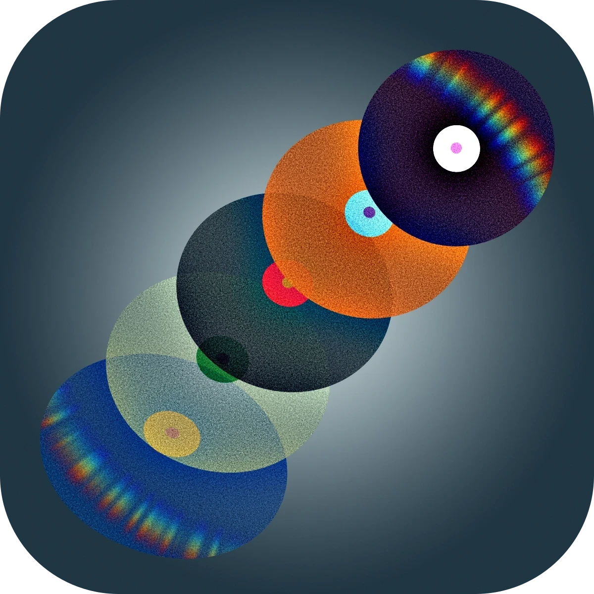
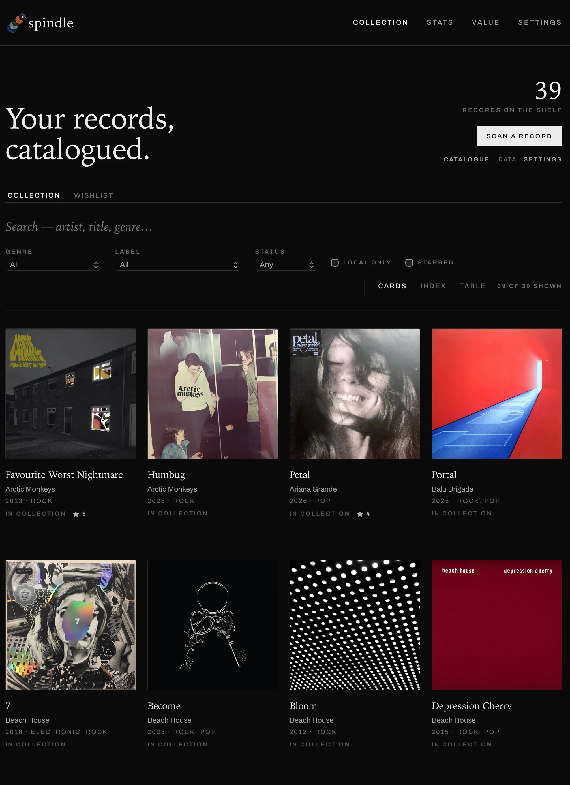
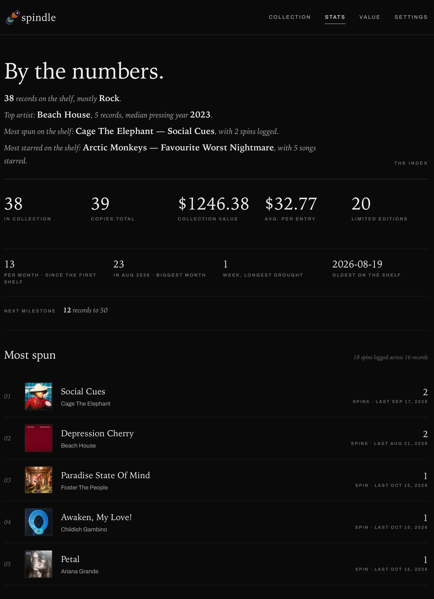
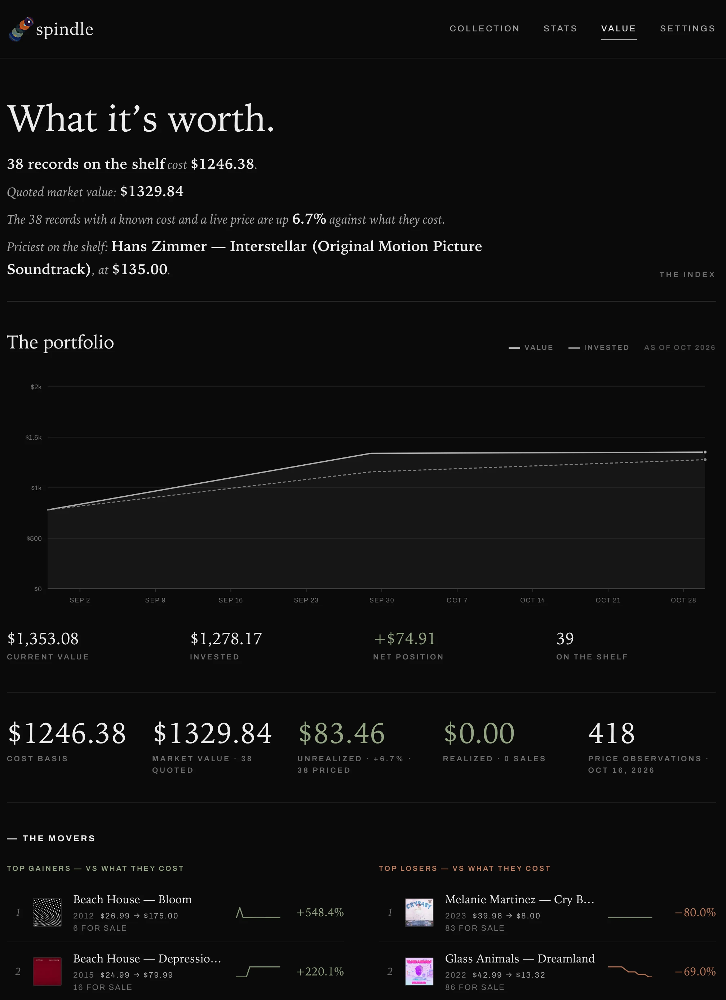

<div align="center">
  
</div>

# spindle

A **lightweight**, **feature-rich**, and **local-first** vinyl record collection tracker. Scan a barcode, pull metadata from Discogs, store records on your digital shelf, see statistics and portfolio values, and more.

Spindle is fully self-hosted: one container (or one Node process), no account, no cloud, no subscription. Your collection is a folder you can back up, restore, and carry to any machine. The runtime is also incredibly efficient: being built with Svelte + SvelteKit and utilizing a minimal set of dependencies, Spindle is a single Node process that idles at **~40 MB of RAM**, with a near-zero disk footprint — the container writes nothing of its own; everything lives in one `./data` directory.

## Screenshots

<table>
  <tr>
    <td align="center" width="34%"></td>
    <td align="center" width="33%"></td>
    <td align="center" width="33%"></td>
  </tr>
  <tr>
    <td align="center"><sub>Collection</sub></td>
    <td align="center"><sub>Stats</sub></td>
    <td align="center"><sub>Value</sub></td>
  </tr>
</table>

## Table of contents

- [Screenshots](#screenshots)
- [Features](#features)
- [Quick start](#quick-start)
- [Configuration](#configuration)
- [Deployment](#deployment)
- [Your data](#your-data)
- [Development](#development)
- [Attributions](#attributions)

## Features

- **Barcode scanning**: camera-based EAN-13/UPC-A scan (native `BarcodeDetector` where available, ZXing JS fallback) plus manual entry
- **Discogs import**: search by barcode, review candidates, and save the release; cover art is **downloaded locally** at import time so the collection browses offline
- **Local-first storage**: SQLite (`data/spindle.db`) + media files (`data/media/`). Discogs is a one-time source of truth; every field is editable afterwards and never overwritten by Discogs
- **Extended schema**: beyond Discogs: condition (media/sleeve), price paid, acquired date, source, copies, limited-edition flag, status, and free-form notes
- **Three views**: cards, index (numbered entries), and table (sortable columns), with search + genre/label/status filters
- **Photos**: upload images of your actual records (client-side downscale to ~1600px JPEG before storage; 25MB per-file server cap)
- **Market value**: manual price snapshots from the Discogs marketplace build an append-only per-record log; `/value` charts portfolio value vs. invested with point-in-time marks and hover tooltips, and each record page shows its own trendline plus gain/loss vs. what you paid
- **Stats**: `/stats` is an aggregate view of your collection with various charts that break down what's on your shelf
- **Printable catalogue**: `/print` is an editorial bound-catalogue page that prints to PDF straight from the browser, and `GET /api/export/catalogue` downloads the same catalogue as a server-rendered PDF (both linked from Settings → Export)
- **Settings & repairs**: theme, appearance, artist display preference, export, backup & restore, and Discogs connection status on `/settings`; `/covers` finds records whose cover art failed to download and retries them
- **Export**: take the collection out as CSV (strict RFC 4180) or JSON — records, photos, plays, and tracks tables — from Settings → Export or `GET /api/export`
- **Backup & restore**: download the entire collection (SQLite DB + every cover and photo) as a single zip, and restore it on any machine; restores validate before touching anything and keep the previous generation in `data/.pre-restore`

## Quick start

The easiest way to run spindle is the pre-built container via Docker Compose. You need Docker (with the Compose plugin); a free [Discogs developer key](https://www.discogs.com/settings/developers) is optional — Discogs import works without one, just at the unauthenticated rate limit (25 req/min instead of 60).

Save this as `docker-compose.yaml`:

```yaml
services:
  spindle:
    image: ghcr.io/momentalab/spindle:latest
    ports:
      - '0.0.0.0:${SPINDLE_PORT:-3737}:3000'
    environment:
      DISCOGS_CONSUMER_KEY: ${DISCOGS_CONSUMER_KEY:-}
      DISCOGS_CONSUMER_SECRET: ${DISCOGS_CONSUMER_SECRET:-}
    volumes:
      - ./data:/data
    restart: unless-stopped
```

Then create the data directory and start:

```sh
mkdir -p data
sudo chown 1000:1000 data   # Linux only — the container runs as uid 1000
docker compose up -d
```

Open <http://localhost:3737> — scan a barcode, or add records manually at `/import/manual`. Camera scanning needs **localhost or HTTPS** (browsers require a secure context for `getUserMedia`).

## Configuration

All configuration is via environment variables (a repo-root `.env` works for both the dev server and Docker Compose):

| Variable                  | Default                                      | Purpose                                                                                 |
| ------------------------- | -------------------------------------------- | --------------------------------------------------------------------------------------- |
| `DISCOGS_CONSUMER_KEY`    | _(empty → unauthenticated tier, 25 req/min)_ | Discogs API consumer key                                                                |
| `DISCOGS_CONSUMER_SECRET` | _(empty)_                                    | Discogs API secret                                                                      |
| `DATA_DIR`                | `./data`                                     | Where the SQLite DB and media files live                                                |
| `BODY_SIZE_LIMIT`         | `512M`                                       | Max request body for adapter-node (restore uploads; photos are capped per-file at 25MB) |
| `SPINDLE_PORT`            | `3737`                                       | Host port for the Docker deployment                                                     |

## Deployment

### Docker Compose (recommended)

Use the [compose file from the quick start](#quick-start), with one change for a permanent deployment — pin a release tag instead of `latest`:

```yaml
image: ghcr.io/momentalab/spindle:v0.1.1
```

- **Port**: listens on `3737` on the host (override with `SPINDLE_PORT`), bound to all interfaces. Put your reverse proxy in front:
- **Behind Caddy / any TLS proxy**: point it at the port, nothing else:

  ```
  reverse_proxy spindle-host:3737   # this host's address (LAN IP, tailnet IP, …)
  ```

  The app derives its origin from the forwarded `Host` header (scheme `https`), so links, redirects, and the CSRF check work behind your proxy with no extra config. Optional: set `ADDRESS_HEADER=x-forwarded-for` + `XFF_DEPTH=1` to log real client IPs.

- **Data**: `./data` → `/data`, so the DB + media survive upgrades. On Linux, chown the folder once before first run (`mkdir -p data && chown 1000:1000 data`) since the container runs as uid 1000. To move an existing collection, drop your old `data/` in place — or use [backup & restore](#backup--restore).
- **Upgrading**: bump the image tag, then `docker compose up -d`; Compose pulls the new image and starts it against the existing data.
- **Stop**: `docker compose down` (data stays in `./data`).

### Build from source

The repo ships a `docker-compose.yaml` that builds the image locally — handy for trying unreleased changes:

```sh
git clone https://github.com/momentalab/spindle.git
cd spindle
docker compose up --build -d
```

For a Linux x64 target from a laptop, build for the target platform instead (`docker buildx build --platform linux/amd64 -t spindle .`). The image is `node:24-slim` and reinstalls runtime deps per platform, so `better-sqlite3` gets the correct prebuilt binary with no compile toolchain.

### Direct Node

Node.js 24+ required (`@zxing/library` enforces it).

```sh
npm install
npm run build     # production build (adapter-node → build/)
PORT=3000 node build/index.js
```

The data directory defaults to `./data` and can be relocated with `DATA_DIR=/path/to/data`.

## Your data

### Export

The whole database can be exported at any time — from Settings (the "Export" section) or straight from a terminal:

```sh
curl -OJ "http://localhost:3737/api/export?format=csv"        # records → CSV
curl -OJ "http://localhost:3737/api/export?format=csv&table=photos"
curl -OJ "http://localhost:3737/api/export?format=json"       # full fidelity (records + photos + plays + tracks)
```

- **CSV** is strictly RFC 4180 (header + rows, CRLF, UTF-8 BOM for Excel), prices in dollars — it opens cleanly in Excel/LibreOffice/pandas.
- **JSON** carries every raw column plus `exported_at`/counts, for backups and tooling.

### Backup & restore

CSV/JSON exports are a snapshot of the _data_; a backup is the whole _thing_ — the SQLite database plus every cover and photo file, in one zip you can drop anywhere.

- **Download**: from the "Backup" section on Settings (or `curl -X POST`), producing e.g. `spindle-backup-2026-08-30T23-00-00.zip`. The WAL is checkpointed first, so the db file inside is a consistent, self-contained snapshot.
- **Restore**: upload that zip from the same section (the browser confirms before it's sent). The server parses and path-checks the archive, opens the candidate database out-of-band and runs `PRAGMA integrity_check` — and only once that passes does it shut the live connection down, preserve the current DB + media in `data/.pre-restore/`, and swap the new generation in. A bad or partial archive aborts with the existing collection byte-for-byte untouched.
- **Safety net**: `.pre-restore/` keeps exactly one previous generation (the files from before the last restore), so a mistaken restore can be put back by restoring _that_ set of files.

```sh
curl -X POST -OJ "http://localhost:3737/api/backup"                  # download the zip
# Production builds assume https for origin checks (behind-TLS deployment), so a
# terminal form-POST needs a matching Origin header, like photo uploads:
curl -X POST -H "Origin: https://localhost:3737" \
     -F "file=@spindle-backup-….zip" "http://localhost:3737/api/restore"
# (Under `npm run dev` the origin check is disabled — plain curl works.)
```

`BODY_SIZE_LIMIT` is 512M by default so media-heavy backup zips can be restored in-app. The UI needs no special handling — the browser sends a same-origin `Origin` automatically.

## Development

Node.js 24+ required (`@zxing/library` enforces it via `engines`).

```sh
npm install
npm run dev      # dev server at http://localhost:5173 (binds to all interfaces, so other devices can scan by IP)
npm run check    # type-check + Svelte diagnostics
npm run build    # production build (adapter-node → build/)
npm run smoke:db # DB-layer smoke test against a scratch database
```

Server logic is covered by verification scripts in `scripts/` that seed a scratch database and assert exact values. The day-to-day loop, the script catalogue, the file map, and code conventions are documented in [DEVELOPMENT.md](./DEVELOPMENT.md).

## Attributions

spindle is built on open-source software:

- [Svelte](https://svelte.dev) + [SvelteKit](https://kit.svelte.dev): the app framework (MIT)
- [Tailwind CSS](https://tailwindcss.com): styling (MIT)
- [better-sqlite3](https://github.com/WiseLibs/better-sqlite3): local SQLite storage (MIT)
- [sharp](https://sharp.pixelplumbing.com): cover & photo image processing (Apache-2.0)
- [pdfkit](https://pdfkit.org): printable catalogue PDF (MIT)
- [archiver](https://github.com/archiverjs/node-archiver) + [unzipper](https://github.com/ZJONSSON/node-unzipper): backup zip in/out (MIT)
- [ZXing JS](https://zxing-js.github.io/library/): barcode scanning (browser wrapper MIT, core library Apache-2.0)

Every dependency is MIT or Apache-2.0 licensed.

---

Made with 🤍 by [Momenta Lab](https://momentalab.com)
